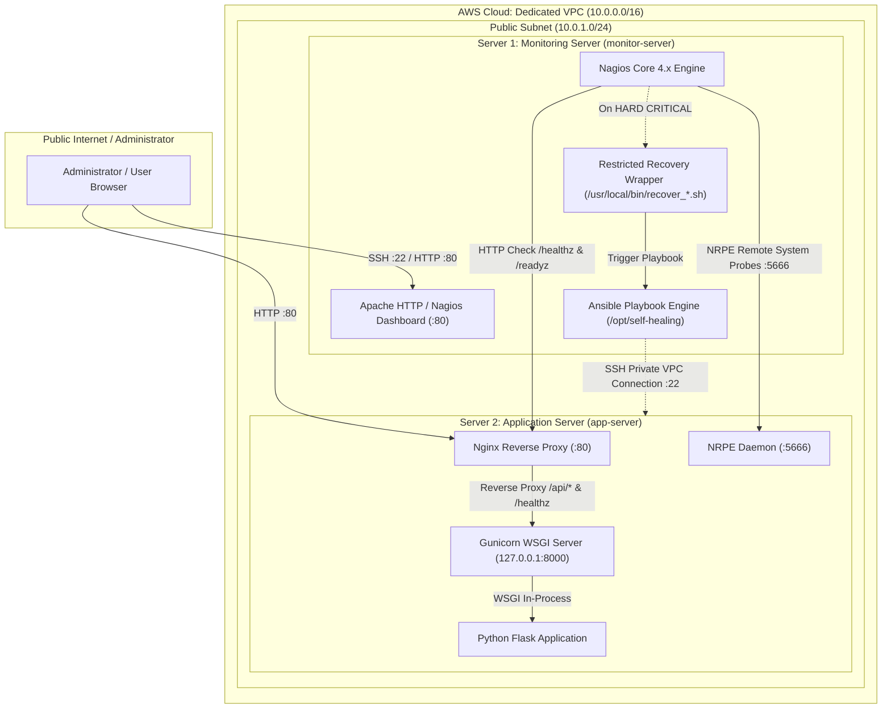
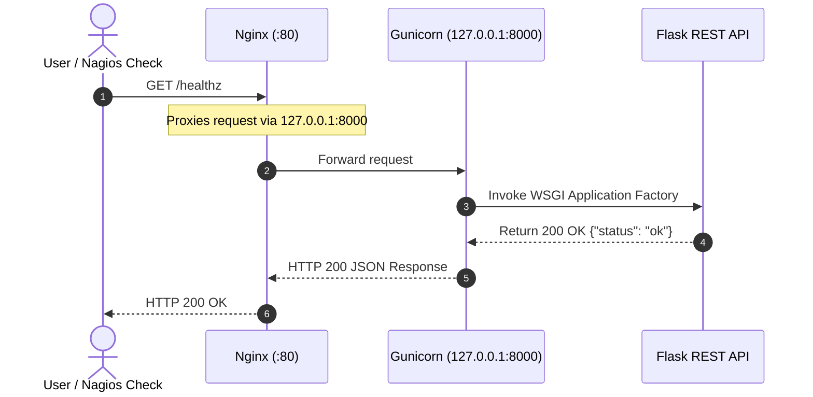

# System Architecture & Technical Specifications

## High-Level Architectural Overview

This project implements an automated, production-grade cloud infrastructure supporting a Python REST backend, reverse-proxied by Nginx, monitored continuously by Nagios Core, and restored autonomously via Ansible event-driven self-healing.

## Network & Security Group Mapping

| Security Group | Ingress Port | Protocol | Source | Purpose |
|---|---|---|---|---|
| `monitor-sg` | `22` | TCP | `admin_ip` | Secure SSH administrative access |
| `monitor-sg` | `80` | TCP | `admin_ip` | Nagios Core Web UI access |
| `monitor-sg` | ICMP | Echo | `admin_ip` | Ping verification |
| `app-sg` | `22` | TCP | `admin_ip` & `monitor-sg` | SSH admin access and Ansible self-healing SSH |
| `app-sg` | `80` | TCP | `0.0.0.0/0` | Public application demonstration & Nginx entry |
| `app-sg` | `5666` | TCP | `monitor-sg` strictly | NRPE host resource monitoring |
| `app-sg` | ICMP | Echo | `monitor-sg` strictly | Nagios host alive ping |

## Request Flow

