# Self-Healing System & Event-Driven Recovery Architecture

## 1. Executive Summary
The primary innovation in this DevOps infrastructure is **closed-loop automated self-healing**. Traditional monitoring systems merely issue notifications when a failure occurs, requiring manual human triage. This project connects **Nagios Core 4.x Event Handlers** to **Ansible Configuration Automation**, enabling automatic remediation of known service failures while enforcing strict security and stability boundaries.

```mermaid
sequenceDiagram
    autonumber
    participant Svc as Flask Backend / Nginx
    participant Nagios as Nagios Core
    participant Wrapper as recover_*.sh (Event Handler)
    participant Ansible as Ansible Playbook Engine
    participant AppHost as app-server (systemd)

    Note over Svc,Nagios: Normal state: Periodic checks return 200 OK
    Svc--xSvc: Failure Occurs (e.g. Process crashes or killed)
    Nagios->>Svc: Scheduled Check (/healthz)
    Svc-->>Nagios: Connection Refused / 502 Bad Gateway
    Note over Nagios: Check Attempt 1/3 (SOFT CRITICAL) - Wait
    Nagios->>Svc: Retry Check Attempt 2/3
    Svc-->>Nagios: Connection Refused (SOFT CRITICAL) - Wait
    Nagios->>Svc: Retry Check Attempt 3/3
    Svc-->>Nagios: Connection Refused -> State transition to HARD CRITICAL

    rect rgb(30, 41, 59)
    Note over Nagios,Ansible: Self-Healing Trigger Phase
    Nagios->>Wrapper: Execute Event Handler (STATE=CRITICAL, TYPE=HARD)
    Wrapper->>Wrapper: Acquire flock & verify cooldown window
    Wrapper->>Ansible: Invoke fixed recovery playbook
    Ansible->>AppHost: Connect via SSH (Private VPC)
    Ansible->>AppHost: Validate configs & restart systemd service
    Ansible->>AppHost: Probe local 127.0.0.1:8000/healthz
    AppHost-->>Ansible: 200 OK
    Ansible-->>Wrapper: Playbook success (rc=0)
    end

    Note over Nagios,Svc: Verification Phase
    Nagios->>Svc: Next scheduled service check
    Svc-->>Nagios: 200 OK -> State transition to OK
    Note over Nagios: System Restored Autonomously
```

## 2. Safety Controls & Reliability Engineering

| Engineering Principle | Implementation Mechanism | Risk Mitigated |
|---|---|---|
| **State Distinction** | Trigger strictly on `HARD CRITICAL` state; ignore `SOFT` state. | Prevents premature recovery runs caused by momentary transient network spikes. |
| **Concurrency Lock** | Linux `flock -n /var/run/recover_*.lock` non-blocking file locking. | Prevents simultaneous duplicate recovery runs if multiple check threads fire. |
| **Cooldown Window** | Enforces minimum interval (60s default) between recovery attempts. | Prevents restart thrashing loops if an underlying issue prevents sustained recovery. |
| **Syntax Pre-Check** | `nginx -t` validation before executing `systemctl restart nginx`. | Prevents restarting into a corrupted configuration that would worsen downtime. |
| **Least Privilege** | Dedicated `/etc/sudoers.d/nagios_recovery` allowing strictly the fixed scripts. | Eliminates risk of arbitrary command injection through Nagios. |
| **State Preservation** | If recovery playbook fails, handler exits non-zero; Nagios remains CRITICAL. | Ensures critical failures are never masked or falsely reported as healthy. |
